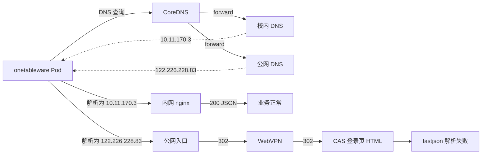
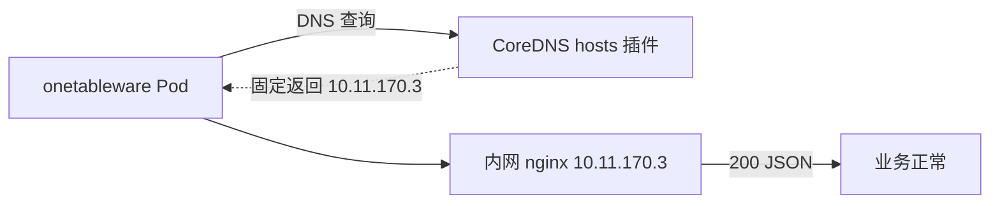

# onetable 服务端接口调用被 WebVPN 强制跳转导致业务报错 —— 故障分析与处理报告

| 项目 | 内容 |
| --- | --- |
| 学校 / 系统 | 上海财经大学浙江学院 · 一表通（onetable） |
| 故障微服务 | `onetableware`（Spring Boot，容器端口 10081，运行于 Rancher / RKE1 集群） |
| 依赖接口域名 | `onetable.shufe-zj.edu.cn` |
| 故障日志时间 | 2026-09-30 17:21:21 ~ 17:22:07（Pod 日志 `container (38).log`） |
| 故障现象 | 业务页面报错，报错内容为 CAS 登录页 HTML |
| 根因 | 微服务服务端调用 `onetable.shufe-zj.edu.cn` 时，域名被解析到公网入口 `122.226.228.83`，该入口对请求强制 302 跳转 WebVPN，返回 HTML 而非 JSON，导致 fastjson 解析失败 |
| 解决方式 | 修改集群 CoreDNS，将 `onetable.shufe-zj.edu.cn` 固定解析到内网 nginx `10.11.170.3`（集群内所有 Pod 生效） |
| 当前状态 | **已恢复**，业务访问正常 |
| 变更时间 / 执行人 | （待补充） |

---

## 1. 故障概述

业务人员反馈"一表通"个人中心相关页面（个人数据纠错、个人数据详情匹配）访问报错，页面上展示的错误内容是一整段 **"Login - 上海财经大学浙江学院"** 的 CAS 登录页 HTML。

经分析，后端微服务 `onetableware` 在服务端通过 HTTP 调用 `https://onetable.shufe-zj.edu.cn` 下的 `portrait`、`lcdpServer` 接口时，请求没有到达内网 nginx，而是走了公网解析，被 WebVPN 判定为"校外访问"并强制 302 跳转到 WebVPN，进而跳转到 CAS 登录页。微服务把拿到的 HTML 当作 JSON 解析，抛出 `com.alibaba.fastjson.JSONException: syntax error, pos 1`，最终把异常信息（含 HTML）返回给前端。

在集群 CoreDNS 中将该域名固定解析到内网 nginx 地址后，问题消除，业务恢复正常。

---

## 2. 环境与涉及组件

| 组件 | 地址 / 标识 | 说明 |
| --- | --- | --- |
| 业务微服务 | `onetableware`，Tomcat 线程 `http-nio-10081-exec-*` | 包名 `com.supwisdom.institute`，通过 `RPCUtil` 调用 onetable 接口 |
| 画像服务接口 | `https://onetable.shufe-zj.edu.cn/portrait/v1/modify/getLatestModifyInfoByCards` | POST，带 token（`RPCUtil.postRequest`） |
| 表单服务接口 | `https://onetable.shufe-zj.edu.cn/lcdpServer/v1/form/getPublishedStructure` | GET，不带 token（`RPCUtil.getRequestWithoutToken`） |
| 表单数据接口 | `https://onetable.shufe-zj.edu.cn/lcdpServer/v1/formData/queryDataByBindingInfo` | 同属 lcdpServer |
| 内网 nginx | `10.11.170.3` | onetable 的内网访问入口，直接返回业务数据 |
| 公网入口 | `122.226.228.83` | 外网解析结果，对该访问路径强制跳转 WebVPN |
| WebVPN | `webvpn.shufe-zj.edu.cn` | 网瑞达 WRD WebVPN（`__vpn_host_crypt_key = "wrdvpnisthebest!"`） |
| CAS | `cass.shufe-zj.edu.cn` | 统一身份认证（由 WebVPN 改写 URL 中的加密主机名解出） |
| K8s 集群 | Rancher / RKE1 | Pod DNS 由 CoreDNS 提供 |
| 测试主机 | `docker8` | 集群节点，用于 curl 验证 |

---

## 3. 故障现象

### 3.1 前端页面报错内容

前端展示的报错内容是一份完整的 CAS 登录页 HTML，且已被 WebVPN 改写，关键特征如下：

```html
<title>Login - 上海财经大学浙江学院</title>
<script>
  var __vpn_hostname_data = "webvpn.shufe-zj.edu.cn";
  var __vpn_protocol_host = "https://webvpn.shufe-zj.edu.cn";
  var __vpn_app_hostname_data = "77726476706e69737468656265737421f3f6528f69236045780dc4b6921b2631ef85dd2f";
  var __vpn_host_crypt = true;
  var __vpn_host_crypt_key = "wrdvpnisthebest!";
  ...
</script>
<!-- 资源路径被改写为 /https/7772.../cas/... -->
<!-- 登录表单回跳地址 -->
service=https://webvpn.shufe-zj.edu.cn/login?cas_login%3Dtrue
```

其中 `__vpn_app_hostname_data` 是 WebVPN 对真实主机名加密后的结果，前 32 位十六进制 `77726476706e69737468656265737421` 即 IV（`wrdvpnisthebest!`），后半段用 AES-CFB 解密后为：

```
f3f6528f69236045780dc4b6921b2631ef85dd2f  ->  cass.shufe-zj.edu.cn
```

说明前端看到的是 **经 WebVPN 代理的 CAS 登录页**。这只是后端异常信息被原样带到前端的表现，真正的问题在后端服务端调用。

### 3.2 业务影响

- 个人中心 → 个人数据纠错（`PersonalCenterController.errorCorrection`）报错
- 个人中心 → 个人数据详情匹配（`PersonalCenterDetailController.match`）报错
- 故障呈间歇性：同一 Pod 内部分请求成功、部分失败

---

## 4. 处理过程时间线

| 阶段 | 内容 | 结论 |
| --- | --- | --- |
| 1. 问题提出 | 提交业务页面报错内容（HTML）及 `onetableware` Pod 日志 | 页面内容为 WebVPN 改写后的 CAS 登录页 |
| 2. 日志分析 | 梳理 `RPCUtil` 调用链、成功与失败请求的时间分布、失败响应的形态 | 服务端调用 onetable 时被 302 到 WebVPN → CAS，不是业务代码或 token 问题 |
| 3. 提出假设 | onetable 域名在服务端存在"内网 / 公网"两种解析路径，公网路径被 WebVPN 强制跳转 | 给出 curl 循环验证方法 |
| 4. 验证 | 在节点 `docker8` 上分别用"hosts 指向内网 nginx"和"外网解析"两种方式各请求 30 次 | 内网 `10.11.170.3` 全部 200；外网 `122.226.228.83` 全部 302 → WebVPN，假设成立 |
| 5. 方案选择 | 方式 A：CoreDNS 统一处理；方式 B：Deployment `hostAliases`；方式 C：节点上游 DNS 只用校内 DNS | 采用 **方式 A** |
| 6. 实施与恢复 | 修改 CoreDNS 配置，将域名固定解析到 `10.11.170.3` | 业务访问恢复正常 |

---

## 5. 日志分析

### 5.1 调用时间线：同一 Pod、同一接口，先成功后失败

| 时间 | 线程 | 接口 | 结果 |
| --- | --- | --- | --- |
| 17:21:22.668 | exec-1 | portrait `getLatestModifyInfoByCards` | 200，返回 JSON |
| 17:21:22.669 | exec-9 | lcdpServer `getPublishedStructure` | 200，返回 JSON |
| 17:21:22.698 | exec-9 | lcdpServer `queryDataByBindingInfo` | 200 |
| 17:21:23.424 | exec-3 / exec-2 | portrait / lcdpServer | 200 |
| 17:21:24.147 | exec-10 / exec-7 | portrait / lcdpServer | 200 |
| 17:21:25.823 | exec-6 / exec-9 | portrait / lcdpServer | 200 |
| 17:21:25.850 | exec-9 | lcdpServer `queryDataByBindingInfo` | 200 |
| **17:21:27.419** | **exec-5** | **portrait `getLatestModifyInfoByCards`** | **失败：裸 302 页面** |
| **17:21:27.419** | **exec-2** | **lcdpServer `getPublishedStructure`** | **失败：CAS 登录页** |

要点：

- 17:21:22 ~ 17:21:25 连续 4 轮调用全部成功，17:21:27 两个接口在同一毫秒发出、同时失败。
- 接口地址、参数格式均未变化，token 也不可能在 2 秒内失效（而且 `getPublishedStructure` 本身不带 token）。
- 因此可以排除业务代码、数据和 token 问题，问题出在 **请求的网络路径** 上。

成功调用的日志示例：

```
2026-09-30 17:21:22.668 DEBUG 1 --- [io-10081-exec-1] com.supwisdom.institute.util.RPCUtil : 请求接口地址为：https://onetable.shufe-zj.edu.cn/portrait/v1/modify/getLatestModifyInfoByCards
2026-09-30 17:21:22.685 DEBUG 1 --- [io-10081-exec-1] com.supwisdom.institute.util.PoaUtil : Fetch response [{"flag":true,"msg":"请求成功","jsonObj":null,"status":200,"data":{"resultList":[{"modifyList":[],"cid":"7f291253-34dd-41cd-9a05-6a12e91259b8"}]}}]
2026-09-30 17:21:22.685  INFO 1 --- [io-10081-exec-1] com.supwisdom.institute.util.RPCUtil : 请求的状态(status)为：200
```

### 5.2 两种失败形态，证明请求被重定向

| 接口 | 请求方式 | 调用方法 | 拿到的响应 | 原因 |
| --- | --- | --- | --- | --- |
| portrait `getLatestModifyInfoByCards` | POST | `RPCUtil.request` ← `postRequest` | 裸 `302 Found` 页面（server 标识为 `none`） | HttpClient 默认 **不跟随** POST 的 302，直接返回重定向页面 |
| lcdpServer `getPublishedStructure` | GET | `RPCUtil.requestWithoutToken` ← `getRequestWithoutToken` | 完整 CAS 登录页，`service=https://webvpn.shufe-zj.edu.cn/login?cas_login%3Dtrue` | HttpClient **跟随** GET 的 302：onetable → WebVPN → CAS 登录页 |

POST 接口失败日志：

```
2026-09-30 17:21:27.419 DEBUG 1 --- [io-10081-exec-5] com.supwisdom.institute.util.RPCUtil : 请求接口地址为：https://onetable.shufe-zj.edu.cn/portrait/v1/modify/getLatestModifyInfoByCards
2026-09-30 17:21:27.479 DEBUG 1 --- [io-10081-exec-5] com.supwisdom.institute.util.PoaUtil : Fetch response [<html><head><title>302 Found</title></head><body><center><h1>302 Found</h1></center><hr><center>none</center></body></html>]
com.alibaba.fastjson.JSONException: syntax error, pos 1, line 1, column 2<html><head><title>302 Found</title></head>...
	at com.alibaba.fastjson.parser.DefaultJSONParser.parse(DefaultJSONParser.java:1510)
	at com.alibaba.fastjson.JSON.parse(JSON.java:181)
	at com.supwisdom.institute.util.PoaUtil.parseJSONObject(PoaUtil.java:166)
	at com.supwisdom.institute.util.RPCUtil.request(RPCUtil.java:46)
	at com.supwisdom.institute.util.RPCUtil.postRequest(RPCUtil.java:23)
	at com.supwisdom.institute.util.PoaPortraitUtils.getLatestModifyInfoByCardIds(PoaPortraitUtils.java:49)
	at com.supwisdom.institute.service.impl.PersonalDataServiceImpl.errorCorrection(PersonalDataServiceImpl.java:258)
	at com.supwisdom.institute.controller.PersonalCenterController.errorCorrection(PersonalCenterController.java:112)
2026-09-30 17:21:27.480 ERROR 1 --- [io-10081-exec-5] c.s.institute.util.PoaPortraitUtils : 查询个人消息异常：syntax error, pos 1, line 1, column 2<html><head><title>302 Found</title></head>...
```

GET 接口失败日志：

```
2026-09-30 17:21:27.419 DEBUG 1 --- [io-10081-exec-2] com.supwisdom.institute.util.RPCUtil : 请求接口地址为：https://onetable.shufe-zj.edu.cn/lcdpServer/v1/form/getPublishedStructure
... PoaUtil : Fetch response [<!DOCTYPE html><html ><head>    <title>Login - 上海财经大学浙江学院</title> ...
com.alibaba.fastjson.JSONException: syntax error, pos 1, line 1, column 2<!DOCTYPE html><html ><head>    <title>Login - 上海财经大学浙江学院</title>...
	at com.supwisdom.institute.util.PoaUtil.parseJSONObject(PoaUtil.java:166)
	at com.supwisdom.institute.util.RPCUtil.requestWithoutToken(RPCUtil.java:126)
	at com.supwisdom.institute.util.RPCUtil.getRequestWithoutToken(RPCUtil.java:19)
	at com.supwisdom.institute.util.PoaFormUtils.getPublishedStructure(PoaFormUtils.java:177)
	at com.supwisdom.institute.service.impl.PersonalDataDetailServiceImpl.match(PersonalDataDetailServiceImpl.java:378)
	at com.supwisdom.institute.controller.PersonalCenterDetailController.match(PersonalCenterDetailController.java:96)
2026-09-30 17:21:27.563 ERROR 1 --- [io-10081-exec-2] c.supwisdom.institute.util.PoaFormUtils : 远程调用表单服务异常：syntax error, pos 1, line 1, column 2<!DOCTYPE html><html ><head>    <title>Login - 上海财经大学浙江学院</title>...
	at com.supwisdom.institute.util.PoaFormUtils.getPublishedStructure(PoaFormUtils.java:180)
```

### 5.3 关键判断：`service` 参数指向 WebVPN

Pod 拿到的 CAS 登录页中，登录回跳地址为：

```
service=https://webvpn.shufe-zj.edu.cn/login?cas_login%3Dtrue
```

如果只是 onetable 自身网关因 token 失效要求登录，`service` 应该指向 onetable 自己的地址。这里指向 WebVPN，说明请求路径是：

```
onetableware Pod
   → https://onetable.shufe-zj.edu.cn/...      （被 302）
   → https://webvpn.shufe-zj.edu.cn/...        （WebVPN 无会话，被 302）
   → https://cass.shufe-zj.edu.cn/cas/login?service=https://webvpn.shufe-zj.edu.cn/login?cas_login=true
```

即 **Pod 的服务端请求被当成"校外访问"，强制送进了 WebVPN 流程**。

### 5.4 代码层面的放大因素

1. `RPCUtil` 没有检查 HTTP 状态码和 `Content-Type`，直接把响应体交给 `PoaUtil.parseJSONObject` 解析，最终报的是 `syntax error, pos 1`，掩盖了"被 302 重定向"这一真实原因。
2. 日志中的 `请求的状态(status)为：200` 取自响应 JSON 体里的 `"status":200` 字段，**不是 HTTP 状态码**，容易误导排查。
3. 异常信息（含整页 HTML）被原样返回给前端，前端又是通过 WebVPN 访问的，于是看到的是被 WebVPN 改写过的 CAS 登录页。

### 5.5 其他发现（与本故障无关）

日志第 1 行：

```
2026-09-30 17:21:21.742 DEBUG 1 --- [io-10081-exec-7] c.s.i.s.i.PersonalDataDetailServiceImpl : syntax error, pos 1, line 1, column 2Z2008263
```

`PersonalDataDetailServiceImpl` 把一个工号/学号字符串（`Z2008263`）当作 JSON 解析。这是独立的小缺陷，级别为 DEBUG，不影响本次结论，已列入后续改进项。

---

## 6. 验证过程

### 6.1 验证方法

在集群节点 `docker8` 上，对同一接口连续请求，输出 HTTP 状态码、实际连接 IP 和重定向地址：

```bash
for i in $(seq 1 30); do
  curl -s -o /dev/null -w '%{http_code} %{remote_ip} %{redirect_url}\n' \
    "https://onetable.shufe-zj.edu.cn/lcdpServer/v1/form/getPublishedStructure"
  sleep 1
done
```

### 6.2 场景一：`/etc/hosts` 将域名指向内网 nginx

在 `docker8` 的 `/etc/hosts` 中加入：

```
10.11.170.3  onetable.shufe-zj.edu.cn
```

结果（两次测试一致）：

```
200 10.11.170.3
200 10.11.170.3
200 10.11.170.3
... （共 14 次，全部 200，无重定向，手动 Ctrl+C 结束）
```

### 6.3 场景二：去掉内部解析，走外网 DNS 解析

结果：

```
302 122.226.228.83 https://webvpn.shufe-zj.edu.cn/https/77726476706e69737468656265737421fff9448826326455301b81b99e506e2fab451625f3075a8a//lcdpServer/v1/form/getPublishedStructure
302 122.226.228.83 https://webvpn.shufe-zj.edu.cn/https/77726476706e69737468656265737421fff9448826326455301b81b99e506e2fab451625f3075a8a//lcdpServer/v1/form/getPublishedStructure
... （30 次全部 302，全部跳转 WebVPN）
```

重定向 URL 中的加密主机段解密结果：

```
fff9448826326455301b81b99e506e2fab451625f3075a8a  ->  onetable.shufe-zj.edu.cn
```

也就是说，公网入口把对 `onetable.shufe-zj.edu.cn` 的访问整体改写成"经 WebVPN 访问 onetable"。

### 6.4 验证结论

| 解析方式 | 连接 IP | HTTP 状态 | 行为 |
| --- | --- | --- | --- |
| 内网解析 | `10.11.170.3`（内网 nginx） | 200 | 正常返回 JSON |
| 外网解析 | `122.226.228.83`（公网入口） | 302 | 强制跳转 WebVPN → CAS 登录 |

该结果与日志分析的推断完全一致，根因得到确认。

---

## 7. 根因分析

### 7.1 直接原因

`onetable.shufe-zj.edu.cn` 存在两种解析结果：

- **内网解析**：`10.11.170.3`，直达内网 nginx，接口正常；
- **公网解析**：`122.226.228.83`，公网入口对该访问路径强制 302 跳转 WebVPN。

`onetableware` 的服务端调用一旦拿到公网解析结果，就会收到 302 / CAS 登录页，fastjson 解析失败，业务报错。

### 7.2 为什么在宿主机改 `/etc/hosts` 对 Pod 不一定生效

RKE1 集群中，Pod 的 DNS 查询发往 CoreDNS，CoreDNS 默认配置为 `forward . /etc/resolv.conf`，即把非集群域名转发给 **节点 `resolv.conf` 中的上游 DNS 服务器**。节点的 `/etc/hosts` 不参与 Pod 的解析（`hostNetwork: true` 的 Pod 除外）。因此第 6 节在 `docker8` 上改 hosts 只用于验证；要让 Pod 生效，必须在 CoreDNS 或 Pod 层面处理。

### 7.3 为什么 Pod 内表现为"时好时坏"（推断，待核实）

日志中同一 Pod 前几秒成功、随后失败，比较符合以下机制：

- 节点 `/etc/resolv.conf` 中可能同时配置了校内 DNS 和公网 DNS。校内 DNS 返回 `10.11.170.3`，公网 DNS 返回 `122.226.228.83`；
- CoreDNS 的 `forward` 插件在多个上游之间随机选择（默认 `policy random`），而且有 `cache 30`；
- JVM 默认也会缓存 DNS 结果约 30 秒（未启用 SecurityManager 时 `networkaddress.cache.ttl` 默认 30 秒），HttpClient 还有连接池复用。

这几层叠加后，会表现为"一段时间内全部成功、一段时间内全部失败"，而且同一时刻发出的两个请求会同时失败，与 17:21:27 的现象吻合。此推断尚未通过逐个查询节点上游 DNS 来确认，见第 9 节待办。

### 7.4 访问路径示意



修复后：



---

## 8. 解决方案

### 8.1 方案对比

| 方案 | 做法 | 生效范围 | 优点 | 缺点 |
| --- | --- | --- | --- | --- |
| **A. CoreDNS 统一处理（已采用）** | 在 CoreDNS Corefile 中用 `hosts` 插件固定解析 | 集群内所有 Pod | 一处修改，全集群生效；无需重启业务 Pod | RKE 执行 `rke up` 或集群升级时配置可能被重置，需要复核 |
| B. Deployment `hostAliases` | 在业务工作负载中加主机别名 | 单个工作负载 | 影响面小，配置随工作负载保存 | 每个调用该域名的服务都要单独配置；会触发滚动重启 |
| C. 修正节点上游 DNS | 节点 `resolv.conf` 只保留校内 DNS | 节点及集群 | 从源头消除内外网解析混用 | 依赖校内 DNS 对该域名返回内网地址；改动节点基础配置，影响面大 |

### 8.2 实施步骤（方式 A）

**1）备份当前 CoreDNS 配置**

```bash
kubectl -n kube-system get configmap coredns -o yaml > coredns-cm-backup-$(date +%Y%m%d%H%M).yaml
```

**2）编辑 ConfigMap**

```bash
kubectl -n kube-system edit configmap coredns
```

在 `.:53 { ... }` 块中、`forward` 之前加入 `hosts` 插件。以下为示意，请以集群实际的 Corefile 为准：

```
.:53 {
    errors
    health {
      lameduck 5s
    }
    ready
    kubernetes cluster.local in-addr.arpa ip6.arpa {
      pods insecure
      fallthrough in-addr.arpa ip6.arpa
    }
    hosts {
      10.11.170.3 onetable.shufe-zj.edu.cn
      fallthrough
    }
    prometheus :9153
    forward . "/etc/resolv.conf"
    cache 30
    loop
    reload
    loadbalance
}
```

注意事项：

- `fallthrough` 必须保留，否则 `hosts` 中未列出的域名不会继续往下转发，会导致其他域名解析失败；
- 同一个 server 块中只能有一个 `hosts` 插件；如果原来已经有 `hosts` 块，直接在里面追加一行即可。

**3）使配置生效**

Corefile 中启用了 `reload` 插件时，CoreDNS 会在一段时间内自动加载新配置。也可以主动重启：

```bash
kubectl -n kube-system rollout restart deployment coredns
kubectl -n kube-system rollout status deployment coredns
kubectl -n kube-system logs -l k8s-app=kube-dns --tail=50   # 确认无报错、出现 reload 记录
```

### 8.3 修复验证

**1）Pod 内解析结果**

```bash
kubectl -n <namespace> exec -it <onetableware-pod> -- getent hosts onetable.shufe-zj.edu.cn
# 预期：10.11.170.3  onetable.shufe-zj.edu.cn
```

**2）Pod 内循环请求**

```bash
kubectl -n <namespace> exec -it <onetableware-pod> -- sh -c '
for i in $(seq 1 30); do
  curl -s -o /dev/null -w "%{http_code} %{remote_ip} %{redirect_url}\n" \
    "https://onetable.shufe-zj.edu.cn/lcdpServer/v1/form/getPublishedStructure"
  sleep 1
done'
# 预期：全部为 200 10.11.170.3，无 redirect_url
```

**3）业务验证**

访问个人中心的"个人数据纠错""个人数据详情"等页面，确认不再出现 CAS 登录页报错；同时观察 `onetableware` 日志，确认不再出现 `JSONException: syntax error, pos 1` 和 `302 Found`。

**结果：业务访问已恢复正常。**

---

## 9. 遗留事项与改进建议

| 序号 | 类别 | 事项 | 建议 |
| --- | --- | --- | --- |
| 1 | 根因核实 | 7.3 节"间歇性"的推断尚未确认 | 查看节点 `/etc/resolv.conf`，对每个上游 DNS 分别 `dig onetable.shufe-zj.edu.cn @<ns>`，确认是否存在内外网解析混用 |
| 2 | 配置持久化 | RKE1 的 CoreDNS 由 addon 模板部署，执行 `rke up`、在 Rancher 中编辑或升级集群时，手工修改的 ConfigMap 可能被重置 | 在变更记录中登记本次修改；集群升级或编辑后复核 Corefile；长期可考虑在 `cluster.yml` 的 `dns.upstreamnameservers` 中只配置校内 DNS（相当于方式 C 的持久化做法） |
| 3 | 同类风险排查 | 其他微服务在服务端调用的校园域名（如 CAS、门户等）可能存在同样问题 | 梳理服务端调用的 `*.shufe-zj.edu.cn` 域名，必要时一并加入 `hosts`，或改为对整个校园域 `shufe-zj.edu.cn:53` 单独转发到校内 DNS |
| 4 | 地址变更联动 | 内网 nginx `10.11.170.3` 如有迁移，CoreDNS 中的硬编码地址需同步修改 | 在 nginx 变更流程中增加"同步 CoreDNS hosts"检查项 |
| 5 | 代码加固 | `RPCUtil` 不检查 HTTP 状态码和 `Content-Type`，日志中的"状态 200"取自响应体 | 遇到 3xx/4xx/5xx 或非 `application/json` 响应时直接报错，并打印 HTTP 状态码和 `Location`；不要把整页 HTML 透传给前端 |
| 6 | 代码缺陷 | `PersonalDataDetailServiceImpl` 将 `Z2008263` 这类字符串当 JSON 解析 | 交开发修复 |
| 7 | 监控 | 目前没有对服务端依赖接口的拨测 | 增加从 Pod 内对 onetable 关键接口的定时探测，出现 302 或非 JSON 响应即告警 |

---

## 附录 A：排查命令汇总

```bash
# 查看解析结果
getent hosts onetable.shufe-zj.edu.cn
nslookup onetable.shufe-zj.edu.cn

# 逐个查询节点上游 DNS
cat /etc/resolv.conf
for ns in $(awk '/^nameserver/{print $2}' /etc/resolv.conf); do
  echo "== $ns"; dig +short onetable.shufe-zj.edu.cn @$ns
done

# 循环请求接口，观察状态码 / 连接 IP / 重定向地址
for i in $(seq 1 30); do
  curl -s -o /dev/null -w '%{http_code} %{remote_ip} %{redirect_url}\n' \
    "https://onetable.shufe-zj.edu.cn/lcdpServer/v1/form/getPublishedStructure"
  sleep 1
done

# CoreDNS 相关
kubectl -n kube-system get configmap coredns -o yaml
kubectl -n kube-system edit configmap coredns
kubectl -n kube-system rollout restart deployment coredns
kubectl -n kube-system logs -l k8s-app=kube-dns --tail=50

# Pod 内验证
kubectl -n <namespace> exec -it <pod> -- getent hosts onetable.shufe-zj.edu.cn
```

## 附录 B：WebVPN URL 中加密主机名的解码方法

网瑞达 WebVPN 的 URL 形如 `/https/<IV 十六进制><密文十六进制>/path`。本环境 key 和 IV 均为 `wrdvpnisthebest!`（页面变量 `__vpn_host_crypt_key` / `__vpn_host_crypt_iv` 中可见），算法为 AES-128-CFB：

```python
from cryptography.hazmat.primitives.ciphers import Cipher, algorithms, modes

key = iv = b"wrdvpnisthebest!"

def decode(cipher_hex: str) -> str:
    d = Cipher(algorithms.AES(key), modes.CFB(iv)).decryptor()
    return (d.update(bytes.fromhex(cipher_hex)) + d.finalize()).decode()

print(decode("fff9448826326455301b81b99e506e2fab451625f3075a8a"))  # onetable.shufe-zj.edu.cn
print(decode("f3f6528f69236045780dc4b6921b2631ef85dd2f"))          # cass.shufe-zj.edu.cn
```

用这个方法可以快速判断一个 WebVPN 跳转 URL 实际指向的是哪个内网系统。
